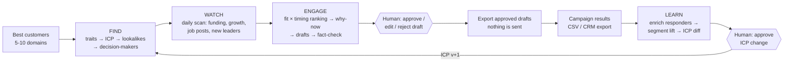
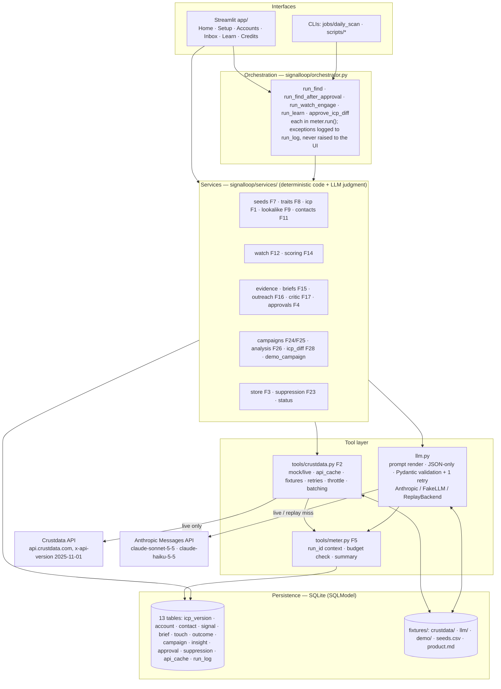

# SignalLoop (MVP)

Closed-loop agentic GTM engine on Crustdata APIs:
**FIND** lookalikes → **WATCH** for buying signals → **ENGAGE** with fact-checked drafts →
**LEARN** which segments responded → propose an **ICP diff** → human approves → repeat.

Nothing is sent or written externally. Every draft and ICP change goes through the approval
inbox; approved drafts are only exported to `exports/approved_outreach.csv`.

## Setup

```powershell
python -m venv .venv
.\.venv\Scripts\python.exe -m pip install -e ".[dev]"
copy .env.example .env   # then fill in ANTHROPIC_API_KEY and CRUSTDATA_API_KEY
```

## Modes

| `SIGNALLOOP_MODE` | Crustdata calls | LLM calls | Use for |
|---|---|---|---|
| `mock` (default) | `api_cache`, else `fixtures/crustdata/*.json`; no network | replay cache `fixtures/llm/` (identical prompt → recorded output), otherwise live and recorded | development, demos |
| `live` | real API calls, responses written to `api_cache` | live (`LLM_REPLAY=record` also saves them) | recording fixtures |

Tests always run in mock mode.


1. **Setup:** the 5 seed domains (Series A software companies found with a live Crustdata
   search) are pre-filled → *Import seeds* → *Extract traits* (coverage %) → the recorded ICP
   description is pre-filled → *Generate ICP* (filters validated by autocomplete, 3,204
   matching companies) → *Approve*.
2. **Accounts:** *Run lookalike search* (tuning log: 3,204 → 802 → 652 → 575; 150 accounts with
   fit scores and reasons) → *Find decision-makers* (champion + economic buyer per account).
3. **Home:** *Run daily scan now* → baseline signals (funding, headcount growth, real job posts).
   Run it again → the **3 day-2 accounts** (Pulley $41M Series B, Infisical $40M, Simplismart
   $14M; real rounds held back by `fixtures/demo/signals_day2.json`) become in-market.
   *Draft outreach* for the top N (about 30 s per account, live LLM).
4. **Inbox:** open a draft → why-now bullets with evidence → critic badge and claim table
   (rewrites shown) → *Approve* / *Edit & approve* / *Reject*.
5. **Learn:** *Generate demo campaign* (SYNTHETIC outcomes over the 326 real contacts, with a
   planted pattern; mock mode first finds decision-makers for every account from fixtures) →
   *Run LEARN* → "VP+ at Series A companies with 20-50 staff replied at 3.6x baseline (n=39)";
   Directors 0.24x (n=74); proposed ICP change.
6. **Inbox → ICP changes:** headcount 20-200 → 20-50, funding stage → Series A only, Directors
   dropped from buyer seniority; each change cites lift and n → *Approve* → ICP v2, lookalike
   re-run converges at 149 matches, the Accounts top 10 is entirely new (Series A, 20-50 staff).
7. **Credits:** credits per run and agent, cache hit rate, LLM cost. In mock mode the credits
   are what the recorded live calls cost (about 545 for the whole loop); a cached replay is 0.

A scripted run of steps 1-7 through the real pages takes about 2 minutes; drafting (step 3)
is the only live LLM step, about 30-70 s per account, and its output is then cached in
`fixtures/llm` so a repeat demo replays it instantly. The planted LEARN pattern was the top
insight for every seed from 1 to 10 (lift 2.6-4.5x, n=39); the recorded demo uses seed 9.

## Business architecture

### Problem and customer

Small B2B startups (2–20 people, no SDR, no RevOps) have three disconnected go-to-market
problems: they don't know **who** to target beyond a few happy customers, **when** a target is
ready to buy, or **what worked** after a campaign. Point tools solve one each and never feed
what they learn back. SignalLoop runs one loop around a single shared, versioned object: the
**ICP (ideal customer profile)**. Every module reads it; LEARN proposes changes to it; a human
approves every change.

| Persona | Job to be done | What SignalLoop gives them |
|---|---|---|
| Founder-seller (pre-seed–Series A) | "Tell me the 10 accounts to contact this week and what to say, in under 15 minutes." | Ranked in-market list, why-now brief, fact-checked drafts in one inbox |
| First GTM hire | "Build lists and campaigns that improve each cycle without spreadsheet analysis." | Segment lift with n, and an ICP change backed by evidence |
| Fractional / agency growth lead | "Stand up a client's ICP, list and first sequence in a day, then show learning." | Seed-to-ICP in minutes, version history of what was learned (F29, Phase 7) |

### The loop as a business process



| Stage | Business question | Output a person acts on | Human decision | Value metric |
|---|---|---|---|---|
| FIND | Who looks like my best customers? | ICP v1 (filters + rationale with coverage %), ~150 ranked accounts, champion + economic buyer per account | Approve / revise the ICP | Seed → approved ICP time; lookalike precision |
| WATCH | Who is ready to buy *now*? | "In market this week" top 10 with the signals behind each score | none (read-only) | Signalled accounts per week |
| ENGAGE | What do I say to whom? | Why-now brief (every bullet cites evidence) + email and LinkedIn draft per contact, each with a critic verdict | Approve / edit & approve / reject each draft | Drafts approved without edits; ungrounded claims shipped (target 0) |
| LEARN | What actually worked? | Segment lift table (n, replies, rate, lift), narrative, proposed ICP diff with evidence | Approve / reject the ICP change | Reply rate ICP v2 vs v1 |

### What makes it trustworthy

- **Evidence-bound claims.** Briefs, drafts and insights may only state facts present in stored
  Crustdata data, the product one-pager, or the analysis table; code validators and the critic
  enforce it (an invented "$50M" against a recorded $41M is caught and rewritten).
- **Human in the loop at every outward or strategic step.** No code path sends email, writes
  to a CRM or posts anywhere (enforced by `tests/test_checkpoint.py`). ICP changes only apply
  after approval and are versioned (`icp_version`, previous version superseded, not deleted).
- **Statistical honesty.** Every insight shows n; n < 30 is flagged low confidence; n < 10 is
  hidden; ICP diffs need lift ≥ 1.5 (or ≤ 0.5) at n ≥ 30 (15 in demo mode).
- **Suppression.** Existing customers, do-not-contact lists, unsubscribes and anyone contacted
  in the last 30 days are never ranked or drafted.

### Unit economics (measured on the recorded run, Crustdata list prices)

| Step | Crustdata credits | LLM (Sonnet 5.5 / Haiku 5.5) | Wall time at 5 RPM |
|---|---|---|---|
| Seeds: identify + enrich 5 domains | 11 | — | ~1 min |
| Traits + ICP + preview count | 0.5 | 2 strong calls | ~25 s |
| Lookalike: 4 count checks + 1 fetch of 150 | ~156 | 3 fast calls | ~1 min |
| Decision-makers, top 30 accounts (2 searches each) | ~36 | — | ~12 min |
| Daily scan (1 job search + 1 discovery search, all watched accounts) | ~23 | — | ~30 s |
| Engage, per account (on-demand staffing + brief + 4 drafts + critic) | ~1.2 | ~13 calls, ≈ $0.02–0.05 | 30–70 s |
| LEARN: import + enrich + analysis + ICP diff | 0 (data already stored) | 2 strong calls | ~10 s |
| ICP v2 lookalike re-run | ~155 | 1 fast call | ~1 min |
| **One full loop (FIND → LEARN → v2), top 30 staffed, 3 accounts engaged** | **≈ 385** | **≈ $0.30** | **≈ 19 min** (rate-limit bound) |

Search premium fields dominate cost (company search filtering + returning taxonomy, headcount
and funding ≈ 1.03 credits/result), which is why lookalike tuning only asks for counts
(`limit=1`) and fetches the list once. The 5 RPM Starter-tier rate limit, not credits, bounds
wall time; higher tiers (15–30 RPM) cut the staffing step to 2–4 minutes.

### Data provenance

| Data | Source |
|---|---|
| Companies, people, funding, headcount growth, job posts | Real Crustdata data (recorded 2026-11-22) |
| Seed customers | 5 real Series A software companies found with a live Crustdata search |
| Day-2 "newly in market" events | Real funding rounds (Pulley $41M, Infisical $40M, Simplismart $14M) held back by the baseline scan |
| Product being sold ("Quillpath") | Fictional one-pager, `fixtures/product.md` |
| Campaign outcomes (opens, replies, meetings) | **Synthetic**, seeded, with a planted pattern (`signalloop/services/demo_campaign.py`) |

## Technical architecture

### Layers



**Design rule:** deterministic plumbing, LLM judgment. Triggers, dedupe, scoring, statistics,
cost control and validation are code; the LLM is used only to interpret (traits, ICP), choose
(one tuning patch, angle), write (briefs, drafts, narratives) and propose (ICP diff), and every
LLM output is schema-validated and, where it states facts, checked against stored data.

### Request path for an external call

```mermaid
sequenceDiagram
    participant S as Service
    participant C as CrustdataClient
    participant M as meter
    participant K as api_cache
    participant F as fixtures/crustdata
    participant A as Crustdata API
    S->>C: company_search(filters, limit)
    C->>K: key = sha256(path | canonical JSON body)
    alt cache hit
        K-->>C: response (0 credits, logged cached)
    else miss
        C->>M: check_budget(list-price estimate)
        alt mock mode
            C->>F: <endpoint>__<key16>.json, else __default.json
        else live mode
            C->>A: POST (throttle 5 RPM/endpoint, retries on 429/5xx, Retry-After)
            A-->>C: JSON + X-Credits-Used
        end
        C->>K: store response + credits
        C->>M: add_credits; run_log row
    end
    C-->>S: response
```

LLM calls follow the same shape in `llm.call_llm`: render `prompts/<name>.md` → system prompt
with the Pydantic JSON Schema → backend → `model_validate_json` + optional semantic validator →
one retry carrying the validation error → `run_log` (model, tokens, latency). With
`ReplayBackend` the key is `sha256(prompt, model, system, messages)` and recorded outputs live
in `fixtures/llm/<prompt>__<key16>.json`.

### Modules, inputs and outputs

| Feature | Module | Crustdata endpoints | LLM prompt (model) | Writes |
|---|---|---|---|---|
| F2 tool layer | `tools/crustdata.py` | all below | — | `api_cache`, `run_log` |
| F5 meter | `tools/meter.py` | — | — | `run_log` (via callers) |
| F3 store | `services/store.py` | — | — | `account`, `contact` (dedupe by Crustdata id → domain / email → profile URL) |
| F23 suppression | `services/suppression.py` | — | — | `suppression` |
| F7 seeds | `services/seeds.py` | `/company/identify`, `/company/enrich` | — | seed accounts (suppressed) |
| F8 traits | `services/traits.py` | — | `extract_traits` (strong) | — (pandas coverage is authoritative) |
| F1 ICP | `services/icp.py` | `/company/search/autocomplete`, `/person/search/autocomplete`, `/company/search` (limit 1) | `icp_to_filters`, `revise_icp` (strong) | `icp_version` |
| F9 lookalike | `services/lookalike.py` | `/company/search` | `tune_filters` (fast), `similarity_reason` (fast, off by default) | accounts, fit scores, `filters_json.tuned` |
| F11 contacts | `services/contacts.py` | `/person/search` ×2 per account | — | contacts (champion / economic buyer) |
| F12 watch | `services/watch.py`, `jobs/daily_scan.py` | `/job/search` (all domains in one call), `/company/search` (discovery) | — | `signal` |
| F14 scoring | `services/scoring.py` | — | — | `account.timing_score`, `priority` |
| F15 brief | `services/briefs.py` + `services/evidence.py` | — | `why_now` (strong) | `brief` |
| F16 outreach | `services/outreach.py` | (on-demand F11) | `write_email` (strong), `write_linkedin` (fast) | `touch`, `approval` |
| F17 critic | `services/critic.py` | — | `critic_extract`, `critic_check` (fast) | `touch.critic_json` |
| F4 approvals | `services/approvals.py` | — | — | `approval`, `exports/approved_outreach.csv` |
| F24/F25 campaigns | `services/campaigns.py` | `/company/enrich`, `/person/enrich`, `/person/identify` (only for missing data) | — | `campaign`, `outcome`, `campaign_<id>.parquet` |
| F26 analysis | `services/analysis.py` | — | `segment_insights` (strong) | `insight`, `campaign.analysis_json` |
| F28 ICP diff | `services/icp_diff.py` | (F9 on approval) | `propose_icp_diff` (strong) | `approval`, new `icp_version` |

Strong = `MODEL_STRONG` (`claude-sonnet-5-5`, default effort, server-side refusal fallback).
Fast = `MODEL_FAST` (`claude-haiku-5-5`, `effort: low`). Drafting runs contacts × channels in
a thread pool (`OUTREACH_PARALLELISM=4`, context copied so meter labels carry over).

### Key algorithms

| Concern | Rule |
|---|---|
| Traits | Per dimension, the smallest set of most frequent values covering ≥ 60% of seeds; LLM explanations must quote "k of n" or the code rejects them |
| ICP validation | Allow-listed fields only; `between` → `=>` + `=<`; `>=`/`<=` → `=>`/`=<`; categorical values matched by free autocomplete (exact, then closest), else dropped with a warning; ISO-3 countries |
| Lookalike tuning | Count-only searches; outside 50–200 the fast model proposes ONE patch; approved filters are locked when tightening (validator + retry); ≤ 4 iterations; fetch once (≤ 150) |
| Fit | Weighted per-dimension credit (industry, headcount, funding stage, geo, growth) with partial credit for adjacent stages and near headcount |
| Timing | `1 − Π(1 − strengthᵢ · e^(−daysᵢ/τ))`, τ per type: funding 45 d, leader change 30 d, job posts 14 d, headcount growth no decay (strength capped at 0.5) |
| Priority | `0.6 · fit + 0.4 · timing` |
| Grounding | Evidence JSON = stored company data + signals + contact + product text; brief refs must resolve to real paths with matching values |
| Critic | Pass A extracts claims; Pass B = code (every number must appear in evidence, rounding-tolerant; unknown money vs known funding = contradicted) + model verdict; stricter wins; ≤ 2 rewrites, then `needs_human` |
| Segment lift | Every dimension, every pair of the 3 dimensions with the largest n-weighted rate variance (segments n ≥ 30 only), and their triple; lift = rate / baseline |
| ICP diff | Eligible insights only; changes must cite them (local labels, mapped to ids) and use allowed fields; proposed spec re-validated before it is queued |

### Determinism, modes and safety

| Mechanism | Purpose |
|---|---|
| `SIGNALLOOP_MODE=mock` | Crustdata from `api_cache` / `fixtures/crustdata` (exact request match); recorded credits replayed so the Credits page shows realistic cost |
| `LLM_REPLAY` (`auto` = replay in mock) | Recorded LLM outputs for identical prompts (`fixtures/llm`), so ICP filters, tuning patches and the ICP diff — which decide the next Crustdata request — are identical in a fresh demo DB; misses call live and are recorded |
| `DEMO_MODE`, `DEMO_AS_OF=2026-11-22` | Scans run "as of" the recording date so signal ages don't drift; day-2 release file |
| Per-person seeded campaign generator; label-based ICP-diff prompt | Same people → same synthetic outcomes → same LEARN prompts, regardless of DB insertion order or row ids |
| `CREDIT_BUDGET_PER_RUN` (500) | A billable call whose estimate would exceed the run budget is refused before it is made |
| `demo_reset.py` | Targets `data/demo.db`; refuses to wipe a DB holding unexported live responses |
| Tests (158) | Mock mode, network blocked, `FakeLLM`; fixture replay tests (`test_replay_find.py`, `test_e2e.py`) run the real recorded data end to end |

### Runtime and configuration

Python 3.11+ (developed on 3.13), `anthropic`, `httpx` + `tenacity`, `pydantic` v2 +
`pydantic-settings`, `sqlmodel` (SQLite, forward-only column migration in `init_db`), `pandas`
+ `pyarrow`, `streamlit` (+ Altair). All settings in `signalloop/config.py`, overridable from
`.env`: keys, `SIGNALLOOP_MODE`, `LLM_REPLAY`, model names and effort, `CRUSTDATA_RPM`,
`CREDIT_BUDGET_PER_RUN`, lookalike / watch / scoring constants, `DB_PATH`, `DEMO_MODE`,
`DEMO_AS_OF`. Crustdata specifics and where the API differs from the original plan:
`docs/crustdata_api_notes.md`.

## Project map

```
signalloop/   config, db, models, schemas, llm (structured calls, FakeLLM, replay cache)
  tools/      crustdata (F2 client), meter (F5)
  services/   store F3 · suppression F23 · seeds F7 · traits F8 · icp F1 · lookalike F9 ·
              contacts F11 · watch F12 · scoring F14 · evidence · briefs F15 · outreach F16 ·
              critic F17 · approvals F4 · campaigns F24/F25 · analysis F26 · icp_diff F28 ·
              demo_campaign · status
  prompts/    one .md per LLM call
  orchestrator.py, jobs/daily_scan.py
app/          Streamlit: Home + pages 1-5
scripts/      recording, export, demo_reset, gen_campaign, seed_llm_replay
fixtures/     crustdata/ (recorded API), llm/ (recorded LLM), demo/ (recordings, day-2 events),
              seeds.csv, product.md (fictional demo product), suppression.csv
tests/        pytest, mock mode, no network
```
